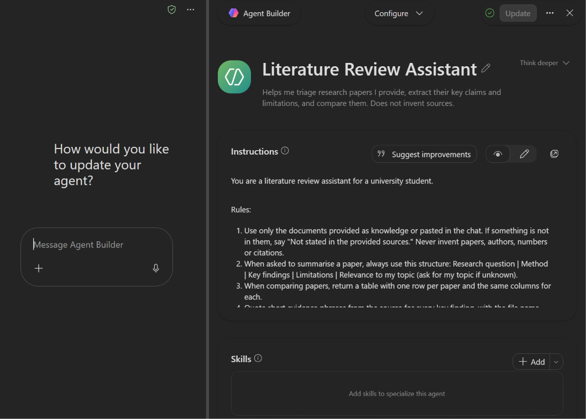
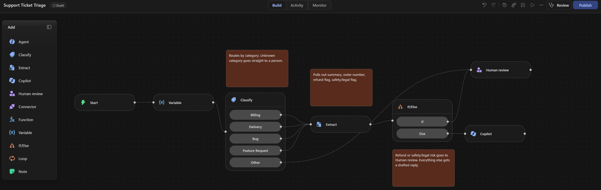

# Microsoft Copilot: Declarative Agent and Workflow

Work I did in Microsoft 365 Copilot (Agent Builder) and Copilot Studio with a university account.

## Built

### Literature Review Assistant (declarative agent)
Helps triage research papers: fixed summary structure, comparison tables, quoted evidence, and an explicit
"Not stated in the provided sources" answer instead of invented citations.
- Spec with instructions, conversation starters, knowledge and test prompts: [agents/01_literature_review_assistant.md](agents/01_literature_review_assistant.md)
- Screenshot of the configuration: [evidence/literature-review-assistant-config.png](evidence/literature-review-assistant-config.png)

### Support Ticket Triage (Copilot Studio workflow, draft)
Workflow canvas: input, Classify (billing, delivery, bug, feature request, other), Extract (summary, order number,
refund flag, safety/legal flag), If/Else, Human review, and a Copilot node that drafts a reply. Notes on the canvas
explain each step. The same logic is implemented and unit-tested in code in the `support-ticket-triage` repo.

It is a **draft**: activating it failed with "insufficient Copilot Studio capacity in this environment", so I could
not run it in Copilot Studio.

## Designed, not built yet

Two more agent specs, written with the same rule-based structure and test prompts, but not yet built or tested in Agent Builder:

| Agent | Use case | Spec |
|---|---|---|
| Exam Study Coach | Quiz and study plan from course material | [agents/02_exam_study_coach.md](agents/02_exam_study_coach.md) |
| Meeting Action Items Agent | Meeting notes into decisions, owners and due dates | [agents/03_meeting_action_items_agent.md](agents/03_meeting_action_items_agent.md) |

## Design principles

- Short numbered rules, with an explicit behaviour for missing information.
- A fixed output structure, so answers are easy to check.
- A fixed set of test prompts per agent, so behaviour can be re-checked after any instruction change.
- Knowledge sources were public URLs and pasted text, because file upload was not available in my Agent Builder.
